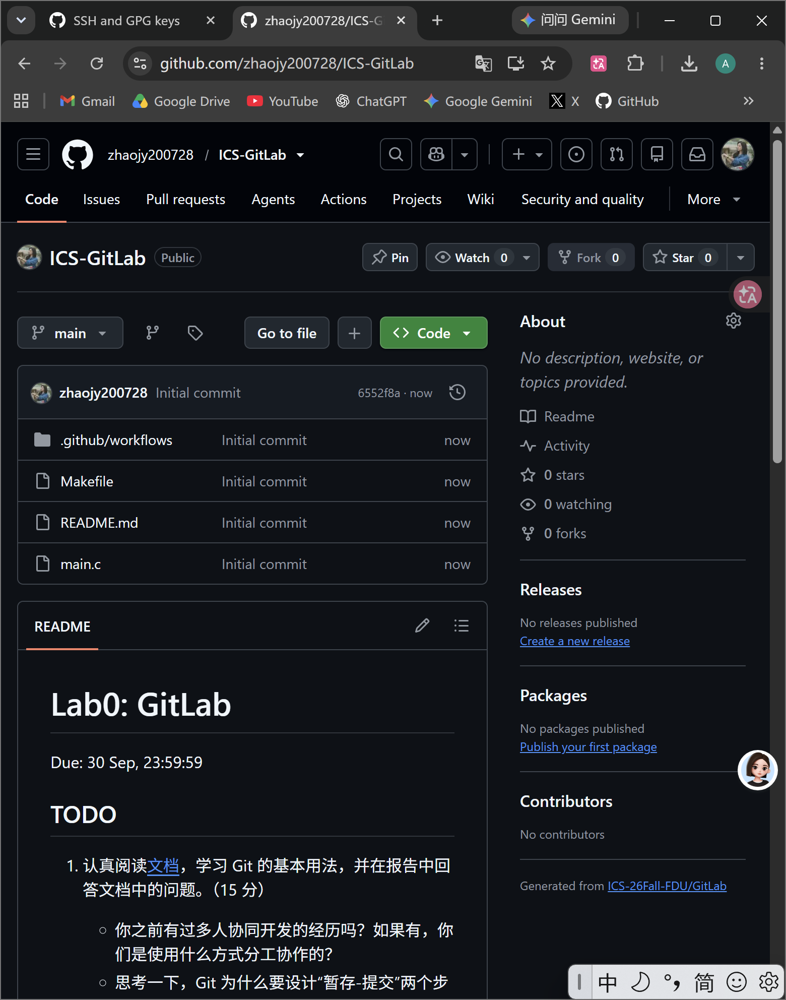
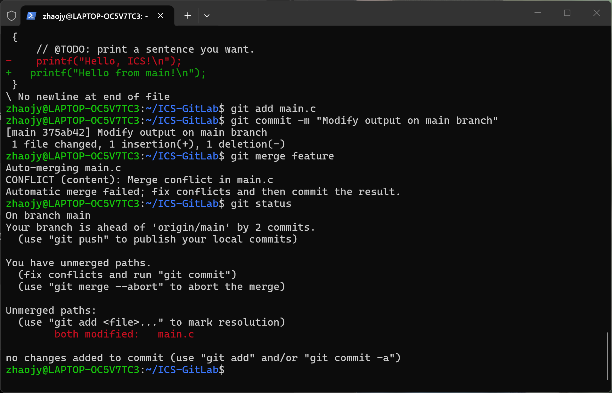
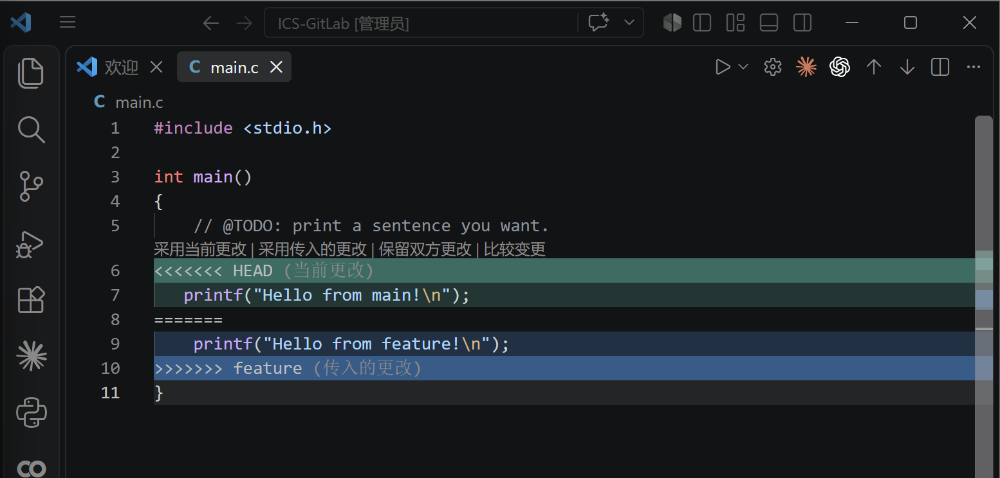
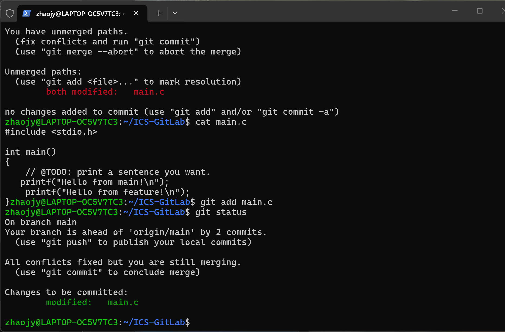
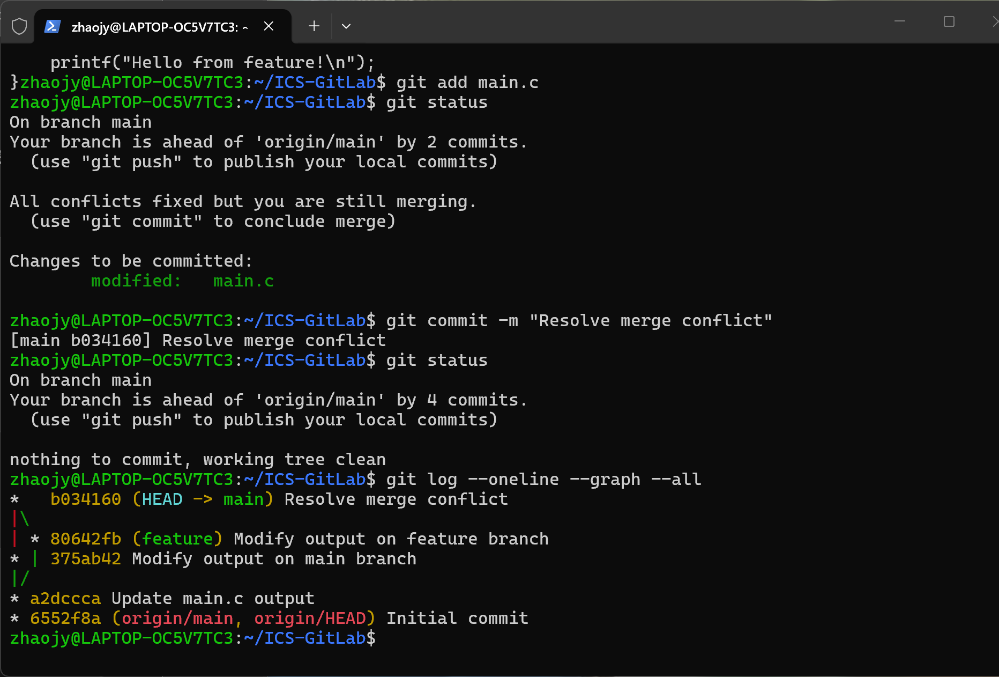

# Lab0 Git 实验报告

姓名：赵静怡  学号25800680034

## 1. 实验目的

本次实验我熟悉了后续课程实验都会反复使用的一套基本工作流：在 Linux 环境中使用 Git 进行版本控制，通过 GitHub 管理远程仓库，并掌握修改、暂存、提交、分支、合并与冲突处理等基本操作。

在实验开始前，我对 Git 的理解主要停留在“把代码放到 GitHub 上”。实际完成 Lab0 后，我逐渐把几个概念区分开：工作区中的文件修改并不等于一次提交；`git add` 负责选择本次准备提交的内容；`git commit` 才把这些内容固定成本地仓库中的一个历史版本；`git push` 则负责将本地已经形成的提交同步到远程仓库。分支则相当于从某个历史节点分出一条新的开发线，使不同修改能够先独立进行，再在需要时合并。

---

## 2. 实验环境与前置配置

### 2.1 WSL2 与 Ubuntu 环境

按照课堂推荐的方法配置了 WSL2，并安装 Ubuntu 发行版作为本学期实验的 Linux 环境。

安装完成后，通过 Windows 终端输入：

```bash
wsl
```

进入 Ubuntu。刚进入 WSL 时，当前路径位于 Windows 文件系统挂载到 Linux 后的位置，例如：

```text
/mnt/c/Users/HUAWEI
```

为了把课程实验保存在 Linux 自己的文件系统中，我使用：

```bash
cd ~
pwd
```

切换到用户主目录，最终实验仓库保存在：

```text
/home/zhaojy/ICS-GitLab
```

实际实验中我主要通过终端和 VS Code 的 WSL 模式操作 Linux 文件。

### 2.2 Ubuntu 软件包管理


安装环境后，完成了软件索引和已安装软件的更新：

```bash
sudo apt update
sudo apt upgrade
```

其中 `sudo` 用于临时以更高权限执行系统级操作；`apt update` 更新软件仓库索引，`apt upgrade` 根据新的索引升级已有软件。

### 2.3 身份配置

按照课程文档配置 Git 提交身份：

```bash
git config --global user.name "Zhao Jingyi"
git config --global user.email "GitHub zhaojy200728@gmail.com"
```

这里使用 `--global`，使配置对当前 Linux 用户的各个 Git 仓库生效。课程还介绍了 system、global 和项目级三层配置，其中项目级优先级最高，本次实验仅使用 global 配置。

### 2.4 GitHub 与 SSH 配置

我注册并登录 GitHub 账号，配置了 SSH。

复制公钥后，在 GitHub 的 `Settings -> SSH and GPG keys` 中添加 Authentication Key。随后执行：

```bash
ssh -T git@github.com
```

得到 GitHub 的成功认证提示，说明 WSL 已能够通过 SSH 与 GitHub 通信。第一次连接时还确认了 GitHub 主机指纹，使其加入本机的 known hosts。


---

## 3. 文档问题回答

### 3.1 之前是否有多人协同开发的经历？如何分工协作？

之前在建模比赛和课程项目中有过多人协作的经历。我们一般先把任务拆成若干部分，例如数据处理、模型实现、结果分析和报告撰写，再由不同成员分别负责。代码量较小时，大家往往直接在群聊或网盘里传文件，或者约定不同人修改不同文件，最后由一个人统一合并。

这种方式在项目比较小时还能使用，但它有明显的问题。第一，文件版本容易混乱，时间久了很难确认哪个才是最新版本；第二，如果两个人同时修改同一个文件，就需要人工逐行比较；第三，即使最后合并成功，也很难完整追溯每一次修改是谁做的、为什么修改。现在经了解发现 Git 的提交历史、分支和合并机制可以把这些容易出错的人工流程变成一套有记录、可追踪的版本控制流程。

### 3.2 Git 为什么要设计“暂存—提交”两个步骤？

刚开始接触时，我觉得 `git add` 和 `git commit` 分成两步似乎有些重复：既然文件已经修改，为什么不能直接把所有修改提交？实际操作之后，我理解到暂存区更像是一次提交之前的“选择区”。

在真实项目中，我可能同时修改很多文件，但这些改动不一定属于同一个任务。例如我一边修复 `main.c` 中的问题，一边修改 README，又顺手写了一半新的测试代码。如果没有暂存区，这些尚未完成或与当前任务无关的改动很容易和真正要提交的内容混在一起。通过 `git add`，可以明确选择“哪些修改属于这一次 commit”；再通过 `git commit` 把这些已经选好的内容固定成一个历史版本。

因此，暂存和提交分成两步使一次 commit 可以更加完整、单一和可解释。以后如果需要查看历史、定位错误、撤销某个修改，清楚的提交粒度也会更加有用。

### 3.3 `git branch` 和 `git branch -a` 的区别是什么？

`git branch` 用于查看本地分支，`git branch -a` 中的 `-a` 是 `--all`，会同时显示本地分支和 Git 已经记录的远程跟踪分支。

在本次实验中，我执行：

```bash
git branch
```

得到：

```text
  feature
* main
```

其中 `*` 表示当前位于 `main` 分支。

执行：

```bash
git branch -a
```

得到：

```text
  feature
* main
  remotes/origin/HEAD -> origin/main
  remotes/origin/main
```

因此，后者额外显示了远程仓库 `origin` 的分支信息。

---

## 4. 阅读材料与对 Git 的理解

课程要求从三篇材料中任选两篇阅读。为了对 Git 在实际项目中的使用方式有更完整的认识，我阅读了三篇。

### 4.1 Commit Message 规范

第一篇材料讨论的是 Commit Message 的写法。提交信息本身就是项目历史的一部分。项目一旦有很多 commit，如果每条信息都过于随意，那么即使 Git 保存了完整历史，人也很难从这些历史中快速得到有价值的信息。

文章中介绍了较为规范的一种写法：

```text
<type>(<scope>): <subject>
```

其中 `type` 表示本次提交的大致类别，例如 `feat`、`fix`、`docs`、`style`、`refactor`、`test`、`chore`；`scope` 可以说明影响范围；`subject` 简短描述这次提交做了什么。对于更复杂的修改，还可以在 Body 中解释具体内容和修改原因，在 Footer 中记录不兼容修改或关联 issue。

Commit Message 让提交记录变成可以被阅读和使用的历史。规范的提交信息可以帮助开发者快速浏览项目发生过什么，也可以按照类型筛选提交，还可以进一步自动生成 Change Log。也就是说，commit message 不只是写给自己看的备注，它也是团队协作和项目维护的一部分。

结合这次实验我之前使用的 `Update main.c output`、`Modify output on feature branch` 已经能说明大致修改目的，但如果按照规范进一步整理，还可以写得更加统一。以后项目复杂后，清楚的 commit message 会比“随便留一句话”重要得多。

### 4.2 Git Flow 分支控制

第二篇材料介绍 Git Flow，进一步帮助我理解了“会创建分支”和“知道什么时候应该创建什么分支”。Git 只提供 `branch`、`switch`、`merge` 等基本能力，而 Git Flow 更像是团队在这些能力之上约定的一套工作流程。

Git Flow 中通常存在两个长期分支：一个是保存稳定发布版本的 `master/main`，另一个是日常开发使用的 `develop`。开发新功能时，从 `develop` 创建独立的 `feature` 分支，功能完成后再合回 `develop`；准备新版本时，可以创建 `release` 分支进行发布前整理和测试；如果线上已经发布的版本突然出现紧急问题，则从稳定版本创建 `hotfix` 分支，修复后再把结果同步回相关长期分支。

这种设计的核心是“不同目的的修改不要全部堆在同一条线上”。本次 Lab 里创建 `feature` 分支只是一个很小的例子，但它和 Git Flow 的思想是一致的：新工作先在独立分支中进行，不影响当前稳定代码，等确认完成后再合并。多人协作时，不同成员可以各自在自己的 feature 分支上工作，既保留独立的修改历史，也避免所有人直接在主分支上同时改动。

还有，分支本身并不是越多越好，重要的是每一种分支有清楚的用途和生命周期。长期分支承担稳定角色，临时分支用于完成特定任务，完成后再合并并删除。这样的约定能让团队成员更容易判断“现在应该在哪个分支做什么事”。

### 4.3 语义化版本


第三篇材料介绍语义化版本（Semantic Versioning）。常见的版本格式是：

```text
X.Y.Z
```

也就是“主版本号.次版本号.修订号”。三个数字并不是简单地按照发布时间依次加一，而是在表达不同程度的软件变化：如果修改破坏了原有 API 的兼容性，需要增加主版本号；如果新增了向下兼容的功能，增加次版本号；如果只是进行了向下兼容的问题修复，则增加修订号。先行版本和构建信息还可以在基本版本号后继续追加。

版本号其实也是一种沟通方式。例如一个项目从 `2.3.1` 更新到 `2.3.2`，按照语义化版本的约定，使用者可以预期这主要是兼容性的修复；如果从 `2.x` 直接变成 `3.0.0`，则意味着需要认真检查是否存在不兼容变化。对于存在大量依赖的软件，其他项目可以根据版本范围判断升级风”。

Git 负责保存代码如何一步步变化，而语义化版本和 tag 则帮助开发者在大量 commit 中标记真正可以对外发布的稳定节点。二者解决的问题不同，但放在一起就形成了从开发历史到正式发布的一套比较完整的版本管理思路。

### 4.4 为什么要学习 Git？

完成三篇阅读和这次实验后，我觉得学习 Git 的意义远不止“把代码上传到 GitHub”。

对个人项目来说，Git 可以清楚记录每次修改，避免不断创建 `final`、`final2`、`final_new` 这样的文件，同时也提供回退到旧版本的能力。对多人项目来说，commit 可以记录每个人做了什么，branch 可以让不同任务并行开发，merge 提供了一套统一的合并机制，而 conflict 则明确告诉开发者哪些地方无法自动决定，需要人工处理。

更进一步看，Commit Message 规范让历史记录变得可读，Git Flow 为多人协作规定分支职责，语义化版本则帮助稳定发布。这些内容共同说明，Git 不只是一个“备份工具”，而是一套围绕软件开发历史、协作和发布建立起来的基础设施。课程之后的 Lab 代码量会逐渐增加，因此越早熟悉这套工作流，后续实验越不容易在版本和提交环节出问题。

---

## 5. 实验过程

### 5.1 使用模板仓库建立个人仓库

在课程提供的模板仓库中点击 `Use this template -> Create a new repository`，建立自己的 `ICS-GitLab` 仓库。保留了课程模板中的初始文件以及 `.github/workflows` 自动检查配置。

创建后的个人仓库如下：



随后在 WSL 的 Linux 主目录中通过 SSH 克隆自己的远程仓库：

```bash
cd ~
git clone git@github.com:zhaojy200728/ICS-GitLab.git
cd ICS-GitLab
```

使用：

```bash
git status
```

确认当前位于 `main` 分支，且工作区最初为 clean。

### 5.2 修改 `main.c` 并完成第一次 commit

模板中的 `main.c` 初始内容为：

```c
printf("Hello, world!\n");
```

按照 TODO 要求，我将其修改为：

```c
printf("Hello, ICS!\n");
```

先使用：

```bash
git diff
```

查看工作区相对于上一次提交的具体变化。随后执行：

```bash
git add main.c
git status
```

此时 `main.c` 从 `Changes not staged for commit` 进入 `Changes to be committed`，说明修改已经进入暂存区。

最后执行：

```bash
git commit -m "Update main.c output"
```

完成第一次正式提交。提交后再次运行 `git status`，工作区恢复为 clean，同时提示本地 `main` 比远程 `origin/main` 多一个 commit。

这一过程也使我实际区分了“修改文件—暂存—提交”三个阶段。

### 5.3 创建 `feature` 分支

在 `main` 已经完成第一次提交的基础上，使用：

```bash
git switch -c feature
```

从当前提交创建并切换到 `feature` 分支。

在 `feature` 中，把同一行修改为：

```c
printf("Hello from feature!\n");
```

然后执行：

```bash
git add main.c
git commit -m "Modify output on feature branch"
```

完成 feature 分支上的提交。

之后使用：

```bash
git switch main
```

切换回 `main`。此时 `main.c` 自动恢复为 main 分支自己的版本，这也直观体现了两个分支可以拥有不同的文件状态。

### 5.4 在 `main` 上进行不同修改

在 `main` 分支中，将同一个位置修改为：

```c
printf("Hello from main!\n");
```

并执行：

```bash
git add main.c
git commit -m "Modify output on main branch"
```

此时 `main` 与 `feature` 已经从共同的提交位置分别向前产生了自己的新 commit，并且修改了同一文件的同一位置。

### 5.5 Merge 并制造冲突

保持在 `main` 分支，执行：

```bash
git merge feature
```

由于两个分支都修改了 `main.c` 的同一行，并且修改内容不同，Git 无法自动判断应该采用哪一边，终端出现：

```text
CONFLICT (content): Merge conflict in main.c
Automatic merge failed; fix conflicts and then commit the result.
```

使用 `git status` 查看后，可以看到：

```text
both modified: main.c
```

冲突出现时的终端如下：



### 5.6 在 VS Code 中解决冲突

打开 `main.c` 后，VS Code 将两边的修改同时显示出来。Git 用 `HEAD` 标记当前 `main` 分支的内容，用 `feature` 标记正在合并进来的内容：



本次实验中，我选择“保留双方更改”，使最终代码同时保留：

```c
printf("Hello from main!\n");
printf("Hello from feature!\n");
```

保存文件后执行：

```bash
git add main.c
git status
```

`git add` 在这里除了把文件加入暂存区，还表示我已经人工确认当前内容就是冲突解决后的最终结果。此时 Git 提示：

```text
All conflicts fixed but you are still merging.
```



最后执行：

```bash
git commit -m "Resolve merge conflict"
```

结束这次 merge。

### 5.7 查看分支与提交历史

实验完成后，执行：

```bash
git branch
git branch -a
```

分别查看本地分支以及本地/远程全部分支。

为了进一步观察刚才的分叉和合并历史，我还使用：

```bash
git log --oneline --graph --all
```

可以看到 `main` 与 `feature` 从同一个 commit 分开，各自形成新的提交，最后通过 `Resolve merge conflict` 的 merge commit 汇合：



---

## 6. 实验总结

本次实验我实际感受了一次控制流程。在环境层面，我完成了 WSL2、Ubuntu、APT、Git、GitHub SSH 和 VS Code WSL 的配置，理解了 Windows 与 Linux 文件系统之间的关系，并将实验放在 Linux 主目录中完成。在 Git 操作层面，我实际经历了 working tree、staging area、commit、branch、merge 和 conflict。

完成 Lab0 后，我对后续实验最基本的流程已经比较清楚：

```text
使用模板建立仓库
-> git clone
-> 修改代码
-> git add
-> git commit
-> git push
-> 提交仓库链接
```

后续实验中代码复杂度会更高，因此这次 Lab0 更像是先把代码之外的版本管理工具准备好，为之后真正的系统实验建立一个稳定的工作流程。
